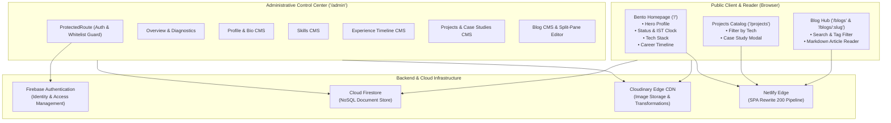

# Piyush Bhagwat — Developer Portfolio V2

[](https://vitejs.dev/)
[](https://react.dev/)
[](https://tailwindcss.com/)
[](https://firebase.google.com/)
[](https://cloudinary.com/)
[]
[](https://www.netlify.com/)

> **A high-contrast, Neo-Brutalist & Bento-Grid developer portfolio, technical publishing hub, and headless administrative CMS.** Engineered with React 18, Vite, Tailwind CSS, Firebase Firestore, and Cloudinary.

---

## ⚡ Built with Antigravity

> [!NOTE]
> **Major architectural, design, and engineering help for Portfolio V2 was provided by [Antigravity](https://deepmind.google/), Google DeepMind's advanced agentic AI coding assistant.**
> 
> Antigravity served as the autonomous pair-programming engineer across the entire V1 &rarr; V2 transformation:
> * **Architectural Blueprints & Roadmapping**: Structured the 7-day vertical slice implementation plan, schema contracts, and edge-case mitigations.
> * **Neo-Brutalist Primitives & Bento Grid**: Implemented tactile UI components (`BentoCard`, `BrutalButton`, `TerminalBox`, `TagBadge`), responsive multi-device grid sizing, and Framer Motion micro-interactions.
> * **Cloudinary Media Pipeline**: Replaced legacy Firebase Storage with zero-cost Cloudinary uploads, resolving complex AbortController blob lifecycle edge cases.
> * **End-to-End Headless CMS**: Built the complete admin suite (`/admin`) for Profile, Skills, Projects/Case Studies, Experiences, and Technical Markdown Blogs.
> * **110-Test Automated Suite**: Authored a custom Node.js test runner with JSX loaders covering all vertical slices with zero linter errors and optimized code-splitting.

---

## 📌 Problems Addressed in V2 (Why the Redesign?)

The original portfolio (V1) served as an initial web developer showcase, but faced significant architectural and operational limitations:

1. **Storage Billing Lock-in & Lack of CDN Transformations**:
   - V1 relied on Firebase Storage, which dropped its zero-cost free tier for portfolio hosting and lacked automatic on-the-fly image optimization (WebP/AVIF compression, responsive scaling).
2. **Hardcoded & Static Content**:
   - Personal bio, career milestones, tech stack, and project case studies were hardcoded directly in JSX strings and static files (`projects.js`). Making any small update required code commits and redeployments.
3. **Absence of a Technical Publication Platform**:
   - No platform existed to write, publish, and share long-form engineering articles, system breakdowns, or technical deep-dives.
4. **Outdated Visual Identity & Cluttered Styling**:
   - Traditional card grids and unmodularized vanilla CSS (`main.style.css`, `mobile.style.css`) lacked a distinct programmer identity, tactile responsiveness, and monospace aesthetic.
5. **Unsecured & Incomplete Management**:
   - The legacy `/manage` route was unprotected without user authentication or robust CRUD capabilities.
6. **SPA 404 Routing on Static Hosts**:
   - Direct navigation or page refreshing on client-side routes (like `/projects` or `/blogs`) on static hosting platforms (Netlify) returned HTTP 404 errors due to missing rewrite rules.

---

## ✨ Core Features & Solutions

### 1. Modern Bento-Grid & Neo-Brutalist Aesthetic
* **Information-Dense Bento Grid**: 6 interactive modular tiles on the homepage (Terminal `$ whoami` Hero, Real-Time IST Metadata, Socials Dock, Tech Stack Matrix, Latest Publication Spotlight, and Featured Applications).
* **Developer Visual Identity**: High-contrast dark mode (`#000000`, `#09090b`), crisp borders (`border-zinc-800`), hard offset brutalist box shadows (`shadow-brutal`), and monospace terminal prompts (`JetBrains Mono`).
* **Tactile Interactions**: Pulsing node badges, micro-elevation hover states, and smooth Framer Motion entrance transitions.

### 2. Zero-Cost Cloudinary Media Pipeline
* **Direct Unsigned Uploads**: Integrated client-side drag-and-drop media dropper utilizing Cloudinary unsigned presets (`portfolio_unsigned`).
* **Dynamic Transformations**: Automatic WebP/AVIF format negotiation (`f_auto`) and quality compression (`q_auto`) served from worldwide Cloudinary CDN edge caches.
* **Resilient Uploader UX**: Handles browser-level MIME-type inconsistencies, blob URL memory cleanup (`URL.revokeObjectURL`), and cancellation safeguards.

### 3. Full Headless CMS Suite (`/admin`)
* **Firebase Authentication Guard**: Strict email whitelisting (`piyushbhagwat5@gmail.com`) protecting all administrative routes via [`ProtectedRoute`](file:///home/piyush/Coding/Projects/portfolio/src/components/common/ProtectedRoute.jsx).
* **Profile & Bio CMS (`/admin/profile`)**: Live preview editor for headline, multi-paragraph bio, location, availability badge, resume URL, and Cloudinary avatar.
* **Skills CMS (`/admin/skills`)**: Categorized competencies (Frontend, Backend, Database, Tools) with custom icons, featured toggles, and order management.
* **Work Experience CMS (`/admin/experience`)**: Chronological timeline manager for roles, companies, dates, locations, descriptions, and technology tags.
* **Projects & Deep Case Studies CMS (`/admin/projects`)**: Full CRUD editor for project catalog, repository/live links, and structured problem-solving Q&A (`challenges: [{ question, solution }]`).
* **Technical Blog Engine (`/admin/blogs` & `/admin/blogs/new`)**: Split-pane Markdown authoring with syntax shortcuts, drag-and-drop image uploading directly into the editor body, and auto-calculated reading times.

### 4. Public Technical Publications & Reader (`/blogs`)
* **Live Search & Topic Filter**: Instant query search and topic tags (`React`, `Architecture`, `Node.js`, etc.) without redundant Firestore queries.
* **Distraction-Free Markdown Reader (`/blogs/:slug`)**: Typography-optimized reading experience featuring GitHub Flavored Markdown, code syntax styling, copy-to-clipboard blocks, and sticky Table of Contents.

### 5. Dedicated Career Timeline on Homepage
* **Chronological Milestones**: Real-world freelance consulting, indie open-source work, and academic computer science milestones directly rendered below the homepage Bento grid.
* **Dynamic Firestore Sync**: Synchronized with the `experiences` collection with seamless fallback defaults.

### 6. Production Static Hosting Configuration (Netlify)
* **Zero 404 Routing**: Hardened single-page app rewrites via [`public/_redirects`](file:///home/piyush/Coding/Projects/portfolio/public/_redirects) (`/* /index.html 200`) and [`netlify.toml`](file:///home/piyush/Coding/Projects/portfolio/netlify.toml).

---

## 🛠️ Tech Stack & Architecture

### Technology Breakdown

| Layer | Technologies |
| :--- | :--- |
| **Frontend Framework** | [React 18](https://react.dev/) (Hooks, Suspense, Context API, Server-Side Rendered Tests) |
| **Build & Bundler** | [Vite 5](https://vitejs.dev/) with optimized manual chunk splitting (`vendor-core`, `vendor-markdown`, `vendor-framer-motion`, `vendor-firebase`, `vendor-icons`) |
| **Styling & Design** | [Tailwind CSS 3](https://tailwindcss.com/) with `@tailwindcss/typography`, custom Neo-Brutalist shadow tokens (`shadow-brutal`), terminal accents |
| **Motion & Micro-interactions** | [Framer Motion 11](https://www.framer.com/motion/) |
| **Database** | [Google Cloud Firestore](https://firebase.google.com/docs/firestore) (Collections: `site_config`, `skills`, `experiences`, `projects`, `blogs`) |
| **Authentication** | [Firebase Auth](https://firebase.google.com/docs/auth) with strict admin email whitelisting |
| **Media CDN** | [Cloudinary](https://cloudinary.com/) (Direct unsigned uploads, on-the-fly transformations `f_auto,q_auto`) |
| **Markdown Processing** | [react-markdown 10](https://github.com/remarkjs/react-markdown) + [remark-gfm 4](https://github.com/remarkjs/remark-gfm) |
| **Icons** | [Lucide React](https://lucide.dev/) & [React Icons](https://react-icons.github.io/react-icons/) |
| **Testing** | Native Node.js Test Runner (`node:test`, `node:assert/strict`) with custom JSX loader — **110 passing tests** |
| **Hosting & CDN** | [Netlify](https://www.netlify.com/) (Continuous Deployment, automated SPA rewrite rules) |

---

### High-Level System Architecture



---

### Firestore Document Schemas

```
Cloud Firestore
├── site_config/
│   └── profile                    --> Personal bio, avatar URL, social links, status badge
├── skills/
│   └── {skillId}                  --> Name, category (frontend|backend|database|tools), icon URL, order
├── experiences/
│   └── {expId}                    --> Role, company, period, location, description, skills_used, order
├── projects/
│   └── {projectId}                --> Title, slug, description, tags, live_url, github_url, case_study
└── blogs/
    └── {blogId}                   --> Title, slug, excerpt, content_markdown, cover_image_url, published
```

---

## 📂 Project Structure

```
portfolio/
├── netlify.toml                               # Netlify build configuration & SPA rewrites
├── public/
│   ├── _redirects                             # Netlify client-side routing fallback rule (200)
│   └── favicon.ico                            # Favicon asset
├── tailwind.config.js                         # Neo-Brutalist & Bento styling tokens
├── vite.config.js                             # Chunk code-splitting & rollup build pipeline
├── test/                                      # Automated test suite (110 tests across 7 slices)
│   ├── jsx-loader.js                          # Node loader for in-memory JSX compilation
│   ├── slice-1.1.test.js ... slice-1.3.test.js# Brutalist primitives & Cloudinary service
│   ├── slice-2.1.test.js ... slice-2.3.test.js# AuthContext, ProtectedRoute, AdminLayout
│   ├── slice-3.1.test.js ... slice-3.4.test.js# ProfileCMS, SkillsCMS, ExperienceCMS, Seeder
│   ├── slice-4.1.test.js ... slice-4.3.test.js# ProjectsCMS, ProjectEditor, CaseStudies
│   ├── slice-5.1.test.js ... slice-5.4.test.js# BlogEditor, CloudinaryDropper, BlogsCMS
│   ├── slice-6.1.test.js ... slice-6.3.test.js# BlogsPage, ArticleReader, ProjectsPage
│   └── slice-7.1.test.js ... slice-7.4.test.js# Bento Homepage, Timeline, Image optimization, Smoke
├── V2/                                        # Architecture specifications & documentation
│   ├── architecture.md                        # Complete technical architecture specification
│   ├── context.md                             # Persistent project memory & history log
│   ├── edge-case.md                           # Edge-case & failure mode analysis
│   ├── implimentation.md                      # 7-day implementation roadmap
│   └── problemm-statment.md                   # Problem statement & gap analysis
└── src/
    ├── components/
    │   ├── brutalist/                         # BentoCard, BrutalButton, TagBadge, TerminalBox, StatusPill
    │   ├── common/                            # ProtectedRoute, ImageUploader
    │   ├── home/                              # HeroTile, StatusTile, SocialsTile, SkillsTile,
    │   │                                      # LatestBlogTile, FeaturedProjectsTile, ExperienceTimeline
    │   ├── layout/                            # PublicNavbar, PublicFooter
    │   └── project/                           # ProjectCard, CaseStudyModal, CaseStudyDrawer
    ├── context/
    │   └── AuthContext.jsx                    # Firebase Auth state & whitelist validation
    ├── layouts/
    │   └── AdminLayout.jsx                    # Admin navigation sidebar & header layout
    ├── pages/
    │   ├── admin/                             # Overview, ProfileCMS, SkillsCMS, ExperienceCMS,
    │   │                                      # ProjectsCMS, BlogsCMS, BlogEditor, Login
    │   └── public/                            # HomePage, ProjectsPage, BlogsPage, BlogPostPage
    ├── services/
    │   ├── cloudinary.js                      # Media upload & on-the-fly transformation service
    │   └── firebase.js                        # Firebase Auth & Cloud Firestore instances
    └── scripts/
        ├── seedData.js                        # Canonical Firestore data seeder
        └── migrateLegacyProjects.js           # Migration utility for legacy case study data
```

---

## 🚀 Getting Started

### Prerequisites
* [Node.js](https://nodejs.org/) (version `18.x` or higher recommended)
* [npm](https://www.npmjs.com/) (version `9.x` or higher)

### Installation
1. Clone the repository:
   ```bash
   git clone https://github.com/Piyush-Bhagwat/portfolio.git
   cd portfolio
   ```
2. Install dependencies:
   ```bash
   npm install
   ```

### Environment Configuration
Create a `.env` file in the project root:

```bash
# Cloudinary Media Configuration
VITE_CLOUDINARY_CLOUD_NAME=your_cloudinary_cloud_name
VITE_CLOUDINARY_UPLOAD_PRESET=your_unsigned_preset

# Firebase Configuration
VITE_FIREBASE_API_KEY=your_firebase_api_key
VITE_FIREBASE_AUTH_DOMAIN=your_project.firebaseapp.com
VITE_FIREBASE_PROJECT_ID=your_project_id
VITE_FIREBASE_STORAGE_BUCKET=your_project.appspot.com
VITE_FIREBASE_MESSAGING_SENDER_ID=your_messaging_sender_id
VITE_FIREBASE_APP_ID=your_app_id

# Admin Security
VITE_ADMIN_EMAIL=your_email@gmail.com
```

### Development & Build Commands

| Command | Action |
| :--- | :--- |
| `npm run dev` | Starts Vite local development server with HMR at `http://localhost:5173` |
| `npm test` | Executes native Node.js test runner across all **110 test suites** |
| `npm run lint` | Runs ESLint with zero-warning threshold enforcement |
| `npm run build` | Compiles production assets into `dist/` with chunk code-splitting |
| `npm run preview`| Locally previews the production build output |

---

## 🧪 Testing & Verification

The project includes automated test coverage powered by Node's native test runner (`node:test`) and server-side component rendering (`react-dom/server`):

```bash
npm test
```

* **110 tests passing** with 0 failures and 0 skipped.
* Covers all 7 vertical slices:
  - Primitive UI & component styling contracts
  - Firebase Authentication state & route guards
  - Admin CMS CRUD workflows and Firestore payloads
  - Markdown editorial parsing and image dropper mechanics
  - Public reader and search filters
  - Bento Grid layout, responsive timeline, and Netlify rewrite rules

---

## 👤 Author

**Piyush Bhagwat**  
*Full Stack Developer & UI Craftsman*

* **Portfolio**: [https://piyushs-portfolio.netlify.app/](https://piyushs-portfolio.netlify.app/)
* **GitHub**: [@Piyush-Bhagwat](https://github.com/Piyush-Bhagwat)
* **LinkedIn**: [/in/piyush-bhagwat](https://www.linkedin.com/in/piyush-bhagwat/)
* **Email**: [piyushbhagwat5@gmail.com](mailto:piyushbhagwat5@gmail.com)


