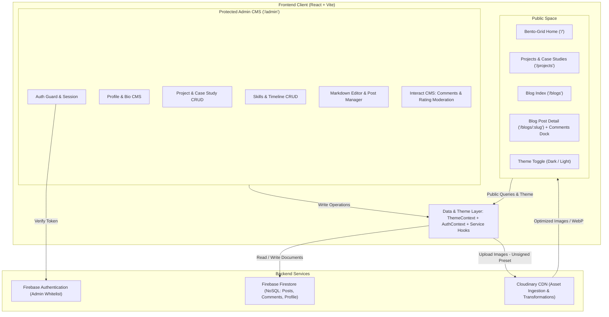
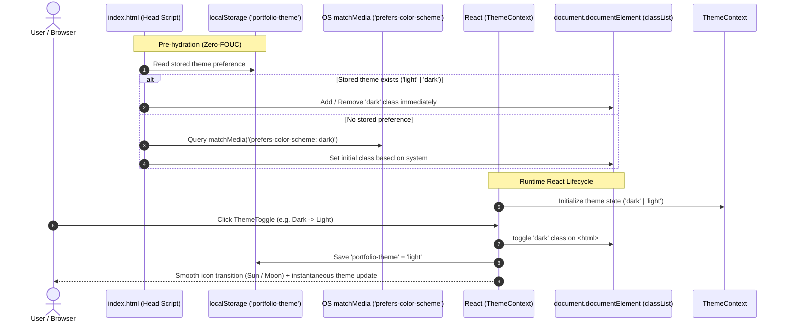
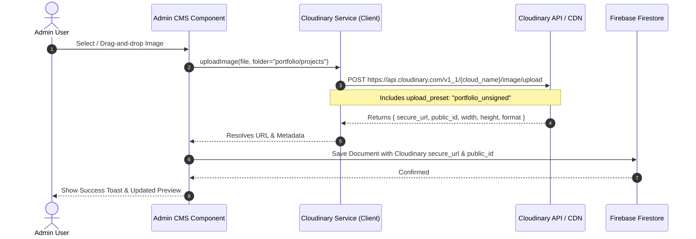
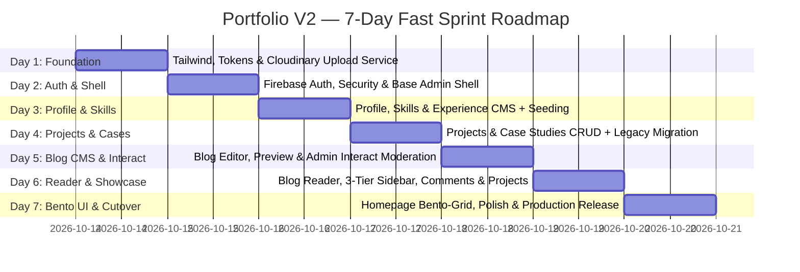

# Portfolio V2 — Detailed System Architecture

## 1. System Overview & Architectural Vision

Portfolio V2 transitions the application from a largely static, hardcoded portfolio into a **dynamic, content-managed developer platform and technical publication hub**. The system couples a modern, high-contrast **Bento-Grid & Neo-Brutalist developer aesthetic** with a flexible **headless CMS architecture** powered by Firebase Firestore and Cloudinary.

### Architectural Objectives
- **Zero Ongoing Infrastructure Cost**: Maximize free-tier limits of Firebase Firestore, Cloudinary CDN, and static hosting (Vercel/Netlify).
- **100% Dynamic Content**: Eliminate hardcoded JSX text, bio details, skills, and case studies; manage everything via an authenticated Admin Suite.
- **Robust Media Delivery**: Offload all asset storage and on-the-fly transformations to Cloudinary CDN.
- **Full Markdown Editorial Pipeline**: Provide an end-to-end authoring and reading experience for engineering articles with code highlighting and media embedding.
- **Scalable Post Interaction & Comments**: Decoupled commenting and rating architecture capable of handling unbounded community discussions with zero read-quota exhaustion via cursor pagination (initial 3, next 10), soft-delete moderation, and denormalized aggregates.
- **Strict Separation of Concerns**: Clean modularization across UI Primitives, Feature Views, Service Adapters, and Context Providers.
- **Dual-Theme Design Architecture**: Deliver an uncompromising aesthetic in both high-contrast Dark Mode and an organic, subtle greenish Light Mode (pale sage, celadon, deep evergreen charcoal) with zero-flash switching and persistent state.

---

## 2. High-Level Architecture Diagram



---

## 3. Frontend Architecture & Routing Structure

### 3.1 Routing Specification (`react-router-dom` v6)

```
/
├── /                     --> Public Bento-Grid Homepage
├── /projects             --> Filterable Projects Grid
├── /projects/:slug       --> Deep Project Case Study View (or interactive drawer/modal)
├── /blogs                --> Technical Blog Index (Search, Tag Filter, Bento Cards with Ratings/Comments)
├── /blogs/:slug          --> Long-form Article Reader (Markdown, TOC, 3-Tier Right Sidebar with Comment Box)
│
└── /admin                --> Admin Gateway
    ├── /admin/login      --> Admin Authentication (Email/Password or OAuth)
    │
    └── (Protected)       --> Requires valid Firebase Auth session
        ├── /admin/overview   --> Quick Stats & Action Center
        ├── /admin/profile    --> Edit Bio, Hero, Photo, Socials, Resume
        ├── /admin/projects   --> Project list, Create / Edit Modal & Case Study Editor
        ├── /admin/skills     --> Skills category manager & reordering
        ├── /admin/experience --> Work timeline & milestone editor
        ├── /admin/blogs      --> Blog Management (Drafts, Published, Delete)
        ├── /admin/blogs/new  --> Split-pane Markdown Editor & Cloudinary Uploader
        ├── /admin/blogs/edit/:id
        └── /admin/blogs/interact --> Cross-post Comment & Review Moderation (Reply, Soft-Hide, Filter)
```

### 3.2 Target Directory Structure (`src/`)

```
src/
├── assets/                  # Brand vectors, favicon, static fallback assets
├── components/
│   ├── brutalist/           # Neo-Brutalist & Bento Primitives
│   │   ├── BentoCard.jsx    # Card wrapper with brutalist borders & hover states
│   │   ├── BrutalButton.jsx # High-contrast button with tactile shadow offset
│   │   ├── TagBadge.jsx     # Monospace tag / tech pill
│   │   ├── TerminalBox.jsx  # macOS/Linux terminal header with window dots
│   │   ├── StatusPill.jsx   # '● Available for work' pulsing badge
│   │   └── ThemeToggle.jsx  # Neo-Brutalist Dark/Light theme switch
│   ├── common/              # Global Navbar, Footer, Modal, Skeleton loaders
│   ├── blog/                # BlogCard, MarkdownRenderer, CodeBlock, TableOfContents
│   │   ├── CommentBox.jsx   # Right-rail expandable comment container (initial 3 + load next 10)
│   │   ├── CommentItem.jsx  # Neo-brutalist comment row with rating stars & admin reply pill
│   │   ├── CommentForm.jsx  # Interactive star rating, author name & comment submission
│   │   └── RatingStars.jsx  # Reusable brutalist star rating input & badge
│   └── project/             # ProjectCard, CaseStudyDrawer, TechStackBadges
│
├── context/
│   ├── AuthContext.jsx      # Admin session state & logout
│   ├── ThemeContext.jsx     # Dark / Light theme provider & persistence
│   └── SiteDataContext.jsx # Cached public data (profile, projects, skills)
│
├── hooks/
│   ├── useAuth.js           # Auth consumption hook
│   ├── useTheme.js          # Theme consumption hook
│   ├── useCloudinary.js     # Upload helper with progress tracking
│   ├── useFirestore.js      # CRUD operations wrapper with error boundaries
│   ├── useReadingTime.js    # Word count and read-time calculator
│   └── useComments.js       # Paginated cursor fetching (3 -> +10), rating submission & soft-delete
│
├── layouts/
│   ├── PublicLayout.jsx     # Header, Main Content, Footer, Contact Dock
│   └── AdminLayout.jsx      # Sidebar navigation, top bar, breadcrumbs
│
├── pages/
│   ├── public/              # Home, Projects, ProjectDetail, Blogs, BlogDetail
│   └── admin/               # Login, Overview, ProfileCMS, ProjectsCMS, BlogEditor, BlogInteractCMS
│
├── services/
│   ├── firebase.js          # App initialization, Firestore references, Auth instance
│   ├── cloudinary.js        # Direct unsigned upload API client
│   └── markdown.js          # Markdown parsing utilities and plugins
│
├── styles/
│   ├── index.css            # Tailwind directives, CSS variables & typography tokens
│   └── brutalist.css        # Custom box-shadow tokens, grid dots background
│
├── App.jsx                  # Route definitions with Suspense / Lazy loading
└── main.jsx                 # Entry point
```

---

## 4. Visual Design System: Minimal, Bento-Grid, Neo-Brutalist & Dual Themes

### 4.1 Design Philosophy & Aesthetics
- **Bento Grid Layout**: Content organized in distinct, asymmetric containers (e.g., 1x1, 2x1, 2x2 spans) producing a cohesive, scannable dashboard.
- **Neo-Brutalist Contrast**: Crisp `1px` or `2px` solid borders (`border-zinc-800` on dark; `#1b2e23` deep evergreen charcoal on light) combined with hard offset drop shadows (`shadow-[4px_4px_0px_0px_rgba(0,0,0,1)]` or `shadow-[4px_4px_0px_0px_#1b2e23]`).
- **Programmer Accents**:
  - Terminal-style window headers (`● ● ●` dots, window title bar).
  - Code prompts: `$ whoami`, `$ cat bio.md`, `$ git log --oneline`, `npm run portfolio`.
  - Monospace micro-typography for dates, tags, commit-style statuses, and metrics.
  - Tactile physical press feedback on active states (`translate(2px, 2px)` with shadow collapse).

### 4.2 Dark Theme Palette Tokens (Terminal Hacker Motif)
- **Background Base**: `#09090b` (Zinc-950)
- **Card Surface**: `#121215` (Zinc-900 / Neutral-900)
- **Card Surface Elevated / Hover**: `#18181b` (Zinc-900) / `#27272a`
- **Borders**: `#27272a` (Zinc-800) / Stark white `#ffffff` for active highlights
- **Accent Primary**: `#10b981` (Emerald-500)
- **Accent Secondary**: `#06b6d4` (Cyan-500)
- **Text Primary**: `#fafafa` (Zinc-50)
- **Text Muted**: `#a1a1aa` (Zinc-400)
- **Text Code / Monospace**: `#38bdf8` (Sky-400)
- **Brutalist Shadow**: `4px 4px 0px 0px rgba(0,0,0,1)`
- **Grid Background**: `radial-gradient(rgba(255, 255, 255, 0.08) 1px, transparent 1px)`

### 4.3 Subtle Greenish Light Theme & Color Theory

```
[ Light Sage Canvas: #f4f7f4 ]
  ├── [ Crisp White Card: #ffffff ]  (High elevation, crisp border #1b2e23)
  │     ├── [ Muted Mint Tile: #e9f0ea ] (Sub-sections, code snippets)
  │     ├── [ Forest Charcoal Text: #0f1a14 ] (15.2:1 contrast ratio)
  │     └── [ Slate Pine Muted: #4b5e53 ] (5.1:1 contrast ratio)
  └── [ Interactive Emerald: #059669 ] (Tactile button + #1b2e23 offset shadow)
```

#### Color Theory Rationale:
1. **Ergonomic Daylight Visual Comfort**: High-luminance stark white (`#ffffff`) canvases generate glare, ocular strain, and feel disconnected from developer tool aesthetics. By introducing a soft, desaturated **celadon/sage tint** (`#f4f7f4`, Lightness ~96%, Saturation ~4%), ambient reflections are softened while retaining a clean, luminous daytime reading surface.
2. **Warmth & Organic Hacker Identity**: Pairing subtle muted green undertones with deep forest charcoal typography invokes the sensation of tactile architectural stationery, engineering grid notebooks, and organic computing.
3. **WCAG 2.1 AA/AAA Contrast Calibration**: Light mode text is not generic gray. Primary copy uses **Deep Forest Charcoal (`#0f1a14`)**, delivering an ultra-crisp **15.2:1 contrast ratio** against `#f4f7f4` (far exceeding the 7:1 WCAG AAA requirement). Muted secondary text uses **Slate Pine (`#4b5e53`)**, providing **5.1:1 contrast** (exceeding WCAG AA 4.5:1).
4. **Accent Value Adjustments**: While `#10b981` (Emerald-500) shines brightly against dark backgrounds, it lacks sufficient luminance contrast on light surfaces (~3.1:1). In light mode, the primary accent dynamically pivots to **Emerald-600 (`#059669`)** and **Emerald-700 (`#047857`)** to guarantee clear visual hierarchy and accessibility (>4.6:1).

#### Light Theme Palette Specifications:
- **Canvas Base**: `#f4f7f4` (Light Sage / Pale Celadon)
- **Card Surface**: `#ffffff` (Crisp Pure White)
- **Secondary / Hover Surface**: `#e9f0ea` (Muted Laurel / Soft Mint)
- **Borders & Outlines**: `#1b2e23` (Deep Evergreen Charcoal, solid `1px` or `2px`)
- **Interior Dividers**: `#cbdad0` (Muted Sage Gray)
- **Text Primary**: `#0f1a14` (Deep Forest Charcoal)
- **Text Muted**: `#4b5e53` (Slate Pine)
- **Text Code / Monospace**: `#047857` (Deep Emerald Monospace) / `#0e7490` (Pine Cyan)
- **Accent Primary**: `#059669` (Emerald-600) / `#047857` (Emerald-700)
- **Accent Secondary**: `#0891b2` (Cyan-600) / `#0e7490` (Cyan-700)
- **Brutalist Shadow**: `4px 4px 0px 0px #1b2e23` (Tactile hard offset)
- **Grid Background**: `radial-gradient(rgba(27, 46, 35, 0.10) 1px, transparent 1px)` (Subtle blueprint dot pattern)

### 4.4 Theme Token Mapping & Contrast Matrix

| Semantic Token | Dark Mode Value | Light Mode (Subtle Green) | Role / Usage | WCAG Ratio (Canvas) |
| :--- | :--- | :--- | :--- | :--- |
| `--bg-base` | `#09090b` (Zinc-950) | `#f4f7f4` (Light Sage) | Full page canvas | Baseline |
| `--card-surface` | `#121215` (Zinc-900) | `#ffffff` (Pure White) | Bento card container | High distinction |
| `--card-surface-subtle` | `#18181b` (Zinc-900) | `#e9f0ea` (Muted Laurel) | Filter chips, code blocks, hovered rows | Clean hierarchy |
| `--border-subtle` | `#27272a` (Zinc-800) | `#1b2e23` (Deep Evergreen) | Neo-brutalist perimeter outlines | > 12:1 (AAA) |
| `--border-divider` | `#1f1f23` | `#cbdad0` (Sage Divider) | Internal horizontal rules & card splits | Soft separation |
| `--text-primary` | `#fafafa` (Zinc-50) | `#0f1a14` (Deep Forest) | Headings, hero text, titles | 15.2:1 (AAA) |
| `--text-muted` | `#a1a1aa` (Zinc-400) | `#4b5e53` (Slate Pine) | Subtitles, dates, descriptions | 5.1:1 (AA) |
| `--accent-primary` | `#10b981` (Emerald-500) | `#059669` (Emerald-600) | Primary CTAs, active status dot, key badges | > 4.6:1 (AA) |
| `--accent-secondary` | `#06b6d4` (Cyan-500) | `#0891b2` (Cyan-600) | Tech stack highlights, links | > 4.5:1 (AA) |
| `--shadow-brutal` | `4px 4px 0px #000000` | `4px 4px 0px #1b2e23` | Neo-brutalist tactile offset shadows | Maximum tactile pop |

### 4.5 Dual-Theme Engine Architecture



1. **Zero-FOUC Execution**: An inline script executes in `<head>` before CSS and DOM hydration, determining whether `'dark'` or `'light'` is applied to `document.documentElement`. This guarantees 0ms layout flash.
2. **Context API (`ThemeContext.jsx`)**:
   - Exposes `{ theme, setTheme, toggleTheme, isDark }`.
   - Listens to OS `matchMedia('change')` events when no explicit preference overrides it.
3. **Interactive Switch (`ThemeToggle.jsx`)**:
   - High-contrast Neo-Brutalist button rendered in `PublicNavbar` and `AdminLayout`.
   - Accessible: `aria-label="Toggle visual theme"` and keyboard reachable.
   - Smooth tactile animation between Sun and Moon icons with rotational micro-physics.

### 4.6 Bento Grid Blueprint for Homepage

```
+-------------------------------------------------------------------------------+
| Header: [ AB ] Logo        [ Home | Projects | Blogs | About ] [ ☀️/🌙 ] [ Contact ] |
+---------------------------------------+---------------------------------------+
| HERO TILE (Span 2x2)                  | STATUS & METRICS TILE (Span 1x1)      |
| $ whoami                              | ● Available for Full-Time Roles       |
| Piyush Bhagwat                        | Location: India (IST)                 |
| Full Stack Developer & UI Craftsman   | Experience: 2+ Years                  |
| Bio summary with brutalist CTA buttons+---------------------------------------+
|                                       | GITHUB STATS / CODING ACTIVITY (1x1)  |
|                                       | Top Tech: React, Node.js, Go/Python   |
+---------------------------------------+---------------------------------------+
| TECH STACK MARQUEE / GRID (Span 2x1)  | FEATURED ARTICLE PREVIEW (Span 1x1)   |
| Interactive badges with hover effects | Latest Post Title + 5 min read        |
| [React] [Node] [Mongo] [Firebase]     | Read Article ->                       |
+---------------------------------------+---------------------------------------+
| FEATURED PROJECTS CAROUSEL / BENTO SLOTS (Span 3x2)                           |
| Bento cards with live preview badges, tech tags, and case-study triggers     |
+-------------------------------------------------------------------------------+
```

---

## 5. Data Architecture & Firestore Document Schemas

All dynamic content is persisted in Cloud Firestore organized across 5 core collections/documents.

### 5.1 Site Profile (`site_config/profile`)
```typescript
interface ProfileConfig {
  name: string;                // "Piyush Bhagwat"
  role: string;                // "Full Stack Developer"
  tagline: string;             // "Crafting minimal, resilient web experiences"
  bio_paragraphs: string[];    // Array of bio paragraphs
  avatar_url: string;          // Cloudinary secure URL
  avatar_public_id: string;    // Cloudinary public ID for deletions
  location: string;            // "Maharashtra, India"
  status_badge: string;        // "Available for new opportunities"
  resume_url: string;          // Cloudinary / Google Drive link
  socials: Array<{
    platform: string;          // "github" | "linkedin" | "x" | "instagram"
    url: string;
    label: string;
  }>;
  updated_at: Timestamp;
}
```

### 5.2 Projects & Case Studies (`projects/{projectId}`)
```typescript
interface ProjectItem {
  id: string;
  title: string;               // "Notes Pool"
  slug: string;                // "notes-pool"
  description: string;         // Short overview for card
  tags: string[];              // ["React", "Firebase", "Tailwind"]
  live_url: string;            // Deployment URL
  github_url: string;          // GitHub repository URL
  image_url: string;           // Cloudinary URL
  image_public_id: string;     // Cloudinary public_id
  featured: boolean;           // Displayed in homepage bento
  order: number;               // Ordering weight
  date: string;                // "2024-05"
  case_study: {
    enabled: boolean;          // Toggle whether case study view is active
    motivation: string;        // Why the project was built
    tech_stack_breakdown: Array<{ tech: string; reason: string }>;
    key_learnings: string[];   // What was learned
    challenges: Array<{
      question: string;        // Issue or bug encountered
      solution: string;        // How it was diagnosed and resolved
    }>;
  };
  created_at: Timestamp;
  updated_at: Timestamp;
}
```

### 5.3 Technical Blogs (`blogs/{blogId}`)
```typescript
interface BlogPost {
  id: string;
  title: string;               // Article title
  slug: string;                // SEO-friendly URL slug (unique)
  excerpt: string;             // Short teaser (1-2 sentences)
  content_markdown: string;    // Full Markdown body
  cover_image_url: string;     // Cloudinary banner image URL
  cover_image_public_id: string;
  tags: string[];              // ["React", "Architecture", "Cloudinary"]
  read_time_minutes: number;   // Calculated on save
  published: boolean;          // Draft vs. Live
  published_at: Timestamp | null;
  // Denormalized Engagement Aggregates (Zero query cost for public lists & cards)
  comment_count: number;       // Total visible comments (incremented/decremented atomically)
  rating_average: number;      // Calculated average rating score (e.g., 4.88)
  rating_count: number;        // Total submitted ratings count
  created_at: Timestamp;
  updated_at: Timestamp;
}
```

### 5.4 Skills (`skills/{skillId}`)
```typescript
interface SkillItem {
  id: string;
  name: string;                // "React JS"
  category: "frontend" | "backend" | "database" | "tools";
  icon_url: string;            // Cloudinary or SVG string
  icon_public_id?: string;
  order: number;
}
```

### 5.5 Experience & Timeline (`experiences/{expId}`)
```typescript
interface ExperienceItem {
  id: string;
  role: string;                // "Frontend Developer"
  company: string;             // "Company / Freelance"
  period: string;              // "Jan 2023 - Present"
  description: string;
  skills_used: string[];
  order: number;
}
```

### 5.6 Blog Comments & Ratings (`comments/{commentId}`)

To prevent unbounded document growth (safeguarding against Firestore's 1MB per-document limit when post discussions cross hundreds or thousands of entries), comments are strictly decoupled into an independent top-level `comments` collection rather than embedded in `BlogPost`. A top-level collection also enables frictionless, performant cross-post querying for the Admin "Interact" moderation inbox without requiring collection-group index overhead.

```typescript
interface BlogComment {
  id: string;
  post_id: string;             // Foreign key referencing blogs/{blogId} (Indexed)
  post_slug: string;           // Slug of target post for instant routing
  post_title: string;          // Denormalized article title for admin inbox display
  author_name: string;         // Visitor display name (max 50 chars)
  rating: number;              // Numeric rating (1 to 5 stars)
  content: string;             // Comment text / review body (max 2000 chars)
  status: "visible" | "hidden";// Soft-delete flag (Never hard deleted; preserves audit trail & ID anchors)
  admin_reply: {               // Official author response
    content: string;           // Admin reply text
    replied_at: Timestamp;     // Timestamp of author response
    author: string;            // "Piyush Bhagwat" (displayed with Verified Author badge)
  } | null;
  created_at: Timestamp;       // Submission timestamp (Indexed for pagination: order by created_at desc)
  updated_at: Timestamp;
}
```

#### Soft-Delete Architecture & Lifecycle Policy:
- **No Hard Deletes**: Comments are **never permanently purged** from Firestore (`allow delete: if false;` enforced in security rules). This prevents broken thread anchors, preserves administrative audit logs, and prevents historical rating data corruption.
- **State Transition**: Admins toggle `status` between `'visible'` and `'hidden'` in the Admin Interact CMS.
- **Atomic Aggregate Pipeline**: Whenever a comment is created or its visibility status toggled, a batched write / transaction atomically updates `comment_count`, `rating_count`, and recalculates `rating_average` on the parent `blogs/{blogId}` document:
  $$\text{new\_avg} = \frac{(\text{old\_avg} \times \text{old\_count}) + \text{new\_rating}}{\text{old\_count} + 1}$$
- If an admin toggles a comment to `'hidden'`, it is deducted from the public aggregates and immediately filtered out of public queries (`where("status", "==", "visible")`).

---

## 6. Media Pipeline & Cloudinary Integration



### Key Cloudinary Optimizations
- **Automatic Format & Quality**: Client render components append `f_auto,q_auto` to Cloudinary delivery URLs for dynamic WebP/AVIF compression.
- **Responsive Sizing**: Render thumbnails using transformed URLs (e.g., `c_fill,w_600,h_400`) to eliminate unnecessary mobile bandwidth consumption.
- **Unsigned Upload Preset**: Configured in Cloudinary dashboard with restricted folder paths (`portfolio/avatars`, `portfolio/projects`, `portfolio/blogs`) and max file size limits (5MB) to avoid exposing API secrets on the client.

---

## 7. Technical Blog Engine Architecture

### 7.1 Authoring & Editor Architecture
The blog editor in `/admin/blogs/editor` operates as a split-pane, distraction-free environment:
- **Left Pane**: Markdown text editor with syntax shortcuts, character counts, and drag-and-drop image dropping directly uploading to Cloudinary and inserting `` at cursor position.
- **Right Pane**: Real-time synchronized preview rendered via `react-markdown` with:
  - `remark-gfm` (Tables, tasklists, strikethrough).
  - Custom code block renderer with `prismjs` or `rehype-highlight` (supporting language badges, line numbers, and 1-click copy).
- **Metadata Drawer**: Title, custom slug with automatic slugification (`/blogs/how-i-built-portfolio-v2`), excerpt, category tags, draft/publish toggle.
- **Auto Read-Time Calculation**: `Math.ceil(wordCount / 200)` updated automatically on change.

### 7.2 Public Reading Architecture
- **Blog Card View (`/blogs`)**: Bento-style grid with tag pills, cover banners, publication dates, read-time badge, real-time average star rating (`★ 4.9`), and comment count (`💬 12`). Instant client-side filtering by query and tag without extra Firestore reads.
- **Article Reader (`/blogs/:slug`)**:
  - Responsive reading container with maximum line-width for optimal readability (`max-w-3xl prose prose-invert`).
  - Sticky/floating Table of Contents derived automatically from `#`, `##`, `###` headings.
  - Sticky progress bar tracking reading percentage.
  - Interactive three-tier right sidebar featuring Table of Contents, Reading Metrics & Actions, and an expandable Comment & Rating Dock.

### 7.3 Post Interaction, Rating & Comment System

#### 7.3.1 Public Blog Card Enhancements (`/blogs` & Bento Previews)
- **Aggregated Metric Pills**: Each blog card in `/blogs` and the homepage Bento preview displays real-time engagement badges:
  - **Rating Pill**: High-contrast brutalist badge with star glyph and average score (e.g., `★ 4.9 (18)`).
  - **Comment Count Pill**: Monospace pill with icon and count (e.g., `💬 12 comments`).
- **Zero Query Overhead**: Sourced directly from denormalized `comment_count` and `rating_average` properties on `BlogPost`. Browsing the blog index triggers **zero** additional queries to the `comments` collection.

#### 7.3.2 Reader Article Header & Metadata Row (`/blogs/:slug`)
- Located immediately beneath the article H1 title and publication date:
  - **Author & Date**: `Piyush Bhagwat · Oct 16, 2026`
  - **Read Time**: `5 min read`
  - **Review & Rating Summary**: Tactile pill displaying average score and count (`★ 4.9 · 18 reviews`).
  - **Comment Count Anchor**: Direct jump link (`💬 18 comments`) that smoothly scrolls and focuses the 3rd Div Comment Box in the right sidebar.

#### 7.3.3 Three-Tier Right Sidebar Layout (`/blogs/:slug`)
On desktop screens (`lg:` and up), the reading view features a sticky three-tier right rail. On smaller viewports (mobile/tablet), these tiers stack cleanly beneath the main article body.

```
+-------------------------------------------------------------+------------------------------------+
| ARTICLE MAIN CANVAS (max-w-3xl prose)                       | RIGHT SIDEBAR (w-80 / w-96)        |
|                                                             |                                    |
| # Building a Scalable Portfolio with React & Firebase       | +--------------------------------+ |
| By Piyush Bhagwat · Oct 16, 2026 · 5 min read               | | 1st DIV: TABLE OF CONTENTS     | |
| ★ 4.9 (18 reviews) | 💬 12 comments                         | | ● System Overview              | |
|                                                             | | ● Data Architecture            | |
| [ Article Markdown Body ... ]                               | | ● Benchmark Results            | |
| [ Code blocks, diagrams, deep-dives ... ]                   | +--------------------------------+ |
|                                                             | | 2nd DIV: ACTIONS & PROGRESS    | |
|                                                             | | Reading Progress: [===== ] 54% | |
|                                                             | | [Share on X] [Copy Link]       | |
|                                                             | +--------------------------------+ |
|                                                             | | 3rd DIV: EXPANDABLE COMMENTS   | |
|                                                             | | ★ ★ ★ ★ ★ (4.9 avg · 18 revs)  | |
|                                                             | | [ Leave a Review / Comment ]   | |
|                                                             | |                                | |
|                                                             | | Recent 3 Comments Preview:     | |
|                                                             | | ┌────────────────────────────┐ | |
|                                                             | | │ Alex · ★★★★★               │ | |
|                                                             | | │ "Brilliant breakdown!"     │ | |
|                                                             | | ├────────────────────────────┤ | |
|                                                             | | │ DevK · ★★★★☆               │ | |
|                                                             | | │ "Clean architecture!"      │ | |
|                                                             | | ├────────────────────────────┤ | |
|                                                             | | │ Sara · ★★★★★               │ | |
|                                                             | | │ "Loved the dark theme."    │ | |
|                                                             | | └────────────────────────────┘ | |
|                                                             | | [ ▼ Expand / View All (12) ]   | |
|                                                             | | -> Cursor-fetches next 10      | |
|                                                             | +--------------------------------+ |
+-------------------------------------------------------------+------------------------------------+
```

#### 7.3.4 Right-Rail Comment Box: Progressive Loading & Cursor Pagination
- **Tier 1 (Initial Load — 3 Comments)**:
  - On page mount, `useComments(postId)` executes a constrained query:
    ```javascript
    query(
      collection(db, "comments"),
      where("post_id", "==", blogId),
      where("status", "==", "visible"),
      orderBy("created_at", "desc"),
      limit(3)
    )
    ```
  - Displays the 3 newest reviews immediately with negligible latency and minimal Firestore read consumption.
- **Tier 2 (Expansion & Cursor-Based Pagination — Next 10)**:
  - Clicking `[ Expand / Load More Comments ]` expands the box into a scrollable comment stream.
  - Queries the next 10 items using Firestore cursor pagination:
    ```javascript
    query(
      collection(db, "comments"),
      where("post_id", "==", blogId),
      where("status", "==", "visible"),
      orderBy("created_at", "desc"),
      startAfter(lastVisibleDoc),
      limit(10)
    )
    ```
  - **Scale Protection**: Even if a post receives thousands of comments, the client only fetches 10 at a time on demand. Memory consumption and Firebase bandwidth stay bounded.
- **Tier 3 (Review Submission & Rating Input)**:
  - Form fields:
    - **Star Rating Selector**: 1 to 5 interactive stars with hover states and brutalist outline.
    - **Author Name**: Plain text input (stored in comment document; no login required for readers).
    - **Comment Text**: Clean textarea with character counter (max 2000 chars).
  - On submission:
    - Writes new document to `comments` with `status: 'visible'` and `admin_reply: null`.
    - Atomically updates post aggregates (`comment_count`, `rating_count`, `rating_average`).
    - Optimistically inserts the new comment at the top of the local review list.

#### 7.3.5 Admin Blog CMS — "Interact" Sub-Section (`/admin/blogs/interact`)
A unified command center for community engagement and moderation across all technical articles:
- **Unified Cross-Post Feed**:
  - Displays a consolidated table of comments from all blog posts simultaneously.
  - Columns:
    - `Article Title`: Denormalized badge linking directly to the post.
    - `Author`: Reader name.
    - `Rating`: Star rating pill (`★ 1-5`).
    - `Snippet`: Excerpt of comment content.
    - `Date`: Submission timestamp.
    - `Status`: High-contrast status pill (`Visible` [Green] vs `Hidden` [Zinc/Red]).
    - `Actions`: `[ Reply ]` and `[ Hide / Unhide ]`.
- **Search & Filter Controls**:
  - **Filter by Post**: Dropdown selector of all published blogs to isolate discussions on a specific article.
  - **Filter by Status**: Quick tabs for `All`, `Visible`, and `Hidden`.
  - **Filter by Rating**: Filter specifically for 5-star praise or <3-star feedback.
- **Admin Inline Reply Mechanism**:
  - Clicking `Reply` opens a brutalist drawer or modal.
  - Admin authors an official response saved under `admin_reply: { content, replied_at, author }`.
  - Displayed publicly nested under the visitor's comment with a distinctive `[ Verified Author ]` badge and accent border.
- **Strict Soft-Delete Strategy**:
  - In accordance with the non-destructive data policy, **hard deletes are disabled** (`allow delete: if false;`).
  - Clicking `Hide` updates `status: 'hidden'` and recalculates the post's public `comment_count` and `rating_average`.
  - Clicking `Unhide` restores the comment to public view and re-adds it to the aggregates.
  - Ensures comments maintain immutable reference IDs, keeps reply threads intact, and preserves full moderation history.

---

## 8. Security & Authentication Architecture

### 8.1 Firebase Authentication
- Authentication is restricted to the site owner via **Firebase Auth** (Email/Password or GitHub OAuth).
- The `AuthContext` provides session state (`currentUser`), token refresh handling, and sign-out capabilities.
- Public routes bypass auth checks entirely; any access to `/admin/*` without an authenticated session triggers an immediate redirect to `/admin/login`.

### 8.2 Firestore Security Rules (`firestore.rules`)
```javascript
rules_version = '2';
service cloud.firestore {
  match /databases/{database}/documents {
    
    // Helper function to check if the user is authenticated admin
    function isAdmin() {
      return request.auth != null && request.auth.token.email == "piyushbhagwat5@gmail.com";
    }

    // Public read-only collections
    match /site_config/{document} {
      allow read: if true;
      allow write: if isAdmin();
    }
    
    match /skills/{skillId} {
      allow read: if true;
      allow write: if isAdmin();
    }
    
    match /experiences/{expId} {
      allow read: if true;
      allow write: if isAdmin();
    }
    
    match /projects/{projectId} {
      allow read: if true;
      allow write: if isAdmin();
    }

    // Blogs: Public can only read published posts; Admin can read and write all
    match /blogs/{blogId} {
      allow read: if resource.data.published == true || isAdmin();
      allow write: if isAdmin();
    }

    // Comments: Decoupled collection for viral scale, ratings, and cross-post moderation
    match /comments/{commentId} {
      // Public can only read visible comments; Admin can read all (including hidden for moderation)
      allow read: if resource.data.status == "visible" || isAdmin();

      // Public submission with strict data integrity & rating bounds
      allow create: if request.resource.data.status == "visible"
                    && request.resource.data.rating >= 1 
                    && request.resource.data.rating <= 5
                    && request.resource.data.author_name.size() > 0 
                    && request.resource.data.author_name.size() <= 50
                    && request.resource.data.content.size() > 0 
                    && request.resource.data.content.size() <= 2000
                    && request.resource.data.admin_reply == null;

      // Only authenticated admin can update comments (replying, toggling status for soft-hide)
      allow update: if isAdmin();

      // HARD DELETE PROHIBITED: Enforces soft-delete strategy at the database rule layer
      allow delete: if false;
    }
  }
}
```

---

## 9. 7-Day Sliced Implementation Roadmap



### 7-Day Vertical Slices Overview:
1. **Day 1: Foundation & Styling System (Vertical Slice: Design Tokens & Cloudinary Asset Service)**
   - Setup Tailwind CSS (`darkMode: 'class'`), typography plugins, Lucide icons, monospace & grotesque typography.
   - Establish semantic CSS custom property design tokens for Dark Mode and subtle greenish Light Mode.
   - Build core Neo-Brutalist / Bento primitives (`BentoCard`, `BrutalButton`, `TerminalBox`, `TagBadge`, `ThemeToggle`).
   - Implement `ThemeContext` and `useTheme` hook with `localStorage` persistence and OS preference synchronization.
   - Implement `src/services/cloudinary.js` for direct unsigned media upload with live verification.
2. **Day 2: Authentication, Security & Base Admin Shell (Vertical Slice: Protected Admin Gateway)**
   - Configure Firebase Authentication for admin email whitelist.
   - Implement `AuthContext`, session persistence, and `<ProtectedRoute />` wrapper.
   - Assemble responsive Admin Layout shell (sidebar navigation, breadcrumb, active route indicator, ThemeToggle button).
   - Configure Firestore Security Rules restricting write access.
3. **Day 3: Profile, Skills & Experience CMS (Vertical Slice: About & Competencies Management)**
   - Build Profile & Bio Editor (`/admin/profile`) with bio paragraphs, Cloudinary avatar upload, and socials.
   - Build Skills CMS (`/admin/skills`) with category grouping and visual ordering.
   - Build Experience & Timeline CMS (`/admin/experience`).
   - Create one-click seed script to populate initial profile and skills data into Firestore.
4. **Day 4: Projects & Case Studies Engine (Vertical Slice: Full Project & Deep Case Study CMS)**
   - Implement Projects CRUD (`/admin/projects`) with tags, live links, and Cloudinary banner uploads.
   - Develop Structured Case Study Builder (`motivation`, `tech_stack_breakdown`, `key_learnings`, `challenges` Q&A pairs).
   - Execute data migration script to ingest all projects from legacy `src/projects.js` into Firestore.
5. **Day 5: Technical Blog System & Admin Interact CMS (Vertical Slice: Markdown Authoring & Comment Moderation)**
   - Develop split-screen Markdown editor (`/admin/blogs/new`, `/admin/blogs/edit/:id`) with live synchronized preview.
   - Implement drag-and-drop Cloudinary image embedding directly into the markdown canvas.
   - Build post metadata controls (SEO slug generation, tags, excerpt, read-time calculation, draft/publish toggle).
   - Build Admin Blog List manager (`/admin/blogs`) with status badges and deletion confirmation.
   - Build Admin Interact CMS (`/admin/blogs/interact`) for unified cross-post comment moderation, filter by post/rating/status, author inline replies, and soft-delete visibility toggles.
6. **Day 6: Public Blog Reader & Projects Showcase (Vertical Slice: Reader Experience, Ratings & Comments Dock)**
   - Construct Public Blog Index (`/blogs`) featuring Bento article cards with star rating summaries (`★ 4.9`), comment counts (`💬 12`), real-time query search, and tag filtering.
   - Implement Public Article Reader (`/blogs/:slug`) with GitHub Flavored Markdown, Prism/Highlight code syntax coloring, copy-to-clipboard buttons, reading progress bar, and metadata review/comment indicators.
   - Assemble three-tier right sidebar housing Table of Contents (Div 1), Actions & Progress (Div 2), and the expandable Comment Box (Div 3) featuring initial 3-comment load, cursor-based pagination for next 10, star rating submission, and verified author reply pills.
   - Redesign Public Projects page (`/projects`) and interactive Case Study modal/drawer with expandable problem-solution accordions.
7. **Day 7: Bento-Grid Homepage Redesign, Dual-Theme Polish & Final Cutover (Vertical Slice: New Homepage & Release)**
   - Re-architect Homepage (`/`) into an information-dense Bento Grid: Terminal hero block (`$ whoami`), live status pill (`● Available for work`), tech stack marquee, featured projects carousel, latest article preview with rating & comment counts, and theme switcher integration.
   - Conduct cross-theme visual verification: ensure full WCAG contrast and brutalist polish across both Dark mode and the subtle greenish Light mode.
   - Conduct cross-device responsive tuning (mobile, tablet, desktop) and tactile brutalist micro-interactions.
   - Execute Lighthouse performance optimization (WebP/AVIF delivery via Cloudinary, code-splitting).
   - Perform final end-to-end verification and cutover checklist.

