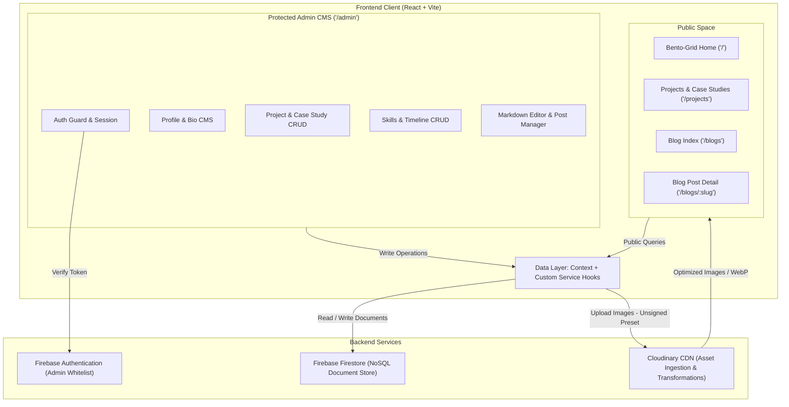
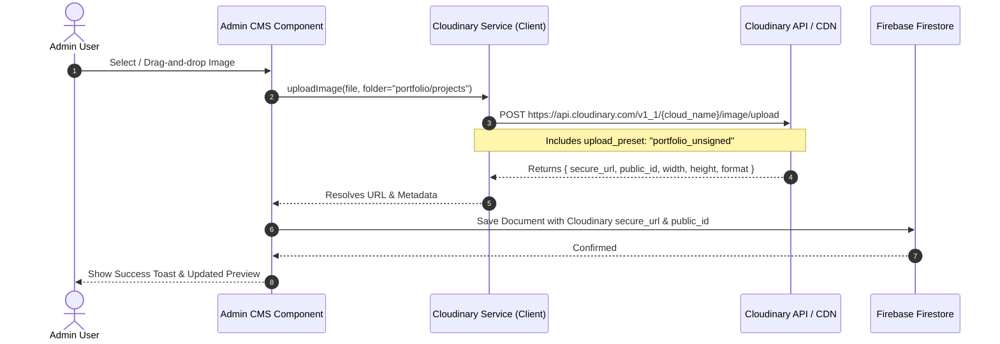
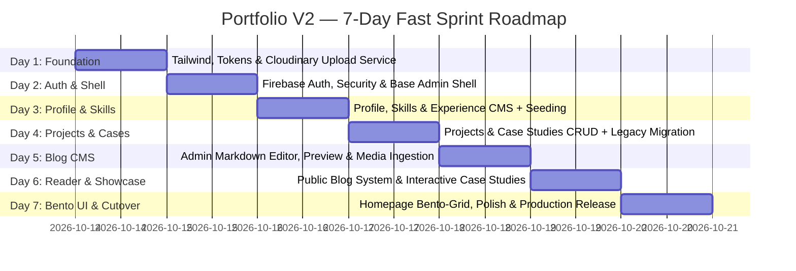

# Portfolio V2 — Detailed System Architecture

## 1. System Overview & Architectural Vision

Portfolio V2 transitions the application from a largely static, hardcoded portfolio into a **dynamic, content-managed developer platform and technical publication hub**. The system couples a modern, high-contrast **Bento-Grid & Neo-Brutalist developer aesthetic** with a flexible **headless CMS architecture** powered by Firebase Firestore and Cloudinary.

### Architectural Objectives
- **Zero Ongoing Infrastructure Cost**: Maximize free-tier limits of Firebase Firestore, Cloudinary CDN, and static hosting (Vercel/Netlify).
- **100% Dynamic Content**: Eliminate hardcoded JSX text, bio details, skills, and case studies; manage everything via an authenticated Admin Suite.
- **Robust Media Delivery**: Offload all asset storage and on-the-fly transformations to Cloudinary CDN.
- **Full Markdown Editorial Pipeline**: Provide an end-to-end authoring and reading experience for engineering articles with code highlighting and media embedding.
- **Strict Separation of Concerns**: Clean modularization across UI Primitives, Feature Views, Service Adapters, and Context Providers.

---

## 2. High-Level Architecture Diagram



---

## 3. Frontend Architecture & Routing Structure

### 3.1 Routing Specification (`react-router-dom` v6)

```
/
├── /                     --> Public Bento-Grid Homepage
├── /projects             --> Filterable Projects Grid
├── /projects/:slug       --> Deep Project Case Study View (or interactive drawer/modal)
├── /blogs                --> Technical Blog Index (Search, Tag Filter, Bento Cards)
├── /blogs/:slug          --> Long-form Article Reader (Markdown, TOC, Code Highlights)
│
└── /admin                --> Admin Gateway
    ├── /admin/login      --> Admin Authentication (Email/Password or OAuth)
    │
    └── (Protected)       --> Requires valid Firebase Auth session
        ├── /admin/overview   --> Quick Stats & Action Center
        ├── /admin/profile    --> Edit Bio, Hero, Photo, Socials, Resume
        ├── /admin/projects   --> Project list, Create / Edit Modal & Case Study Editor
        ├── /admin/skills     --> Skills category manager & reordering
        ├── /admin/experience --> Work timeline & milestone editor
        ├── /admin/blogs      --> Blog Management (Drafts, Published, Delete)
        └── /admin/blogs/new  --> Split-pane Markdown Editor & Cloudinary Uploader
        └── /admin/blogs/edit/:id
```

### 3.2 Target Directory Structure (`src/`)

```
src/
├── assets/                  # Brand vectors, favicon, static fallback assets
├── components/
│   ├── brutalist/           # Neo-Brutalist & Bento Primitives
│   │   ├── BentoCard.jsx    # Card wrapper with brutalist borders & hover states
│   │   ├── BrutalButton.jsx # High-contrast button with tactile shadow offset
│   │   ├── TagBadge.jsx     # Monospace tag / tech pill
│   │   ├── TerminalBox.jsx  # macOS/Linux terminal header with window dots
│   │   └── StatusPill.jsx   # '● Available for work' pulsing badge
│   ├── common/              # Global Navbar, Footer, Modal, Skeleton loaders
│   ├── blog/                # BlogCard, MarkdownRenderer, CodeBlock, TableOfContents
│   └── project/             # ProjectCard, CaseStudyDrawer, TechStackBadges
│
├── context/
│   ├── AuthContext.jsx      # Admin session state & logout
│   └── SiteDataContext.jsx # Cached public data (profile, projects, skills)
│
├── hooks/
│   ├── useAuth.js           # Auth consumption hook
│   ├── useCloudinary.js     # Upload helper with progress tracking
│   ├── useFirestore.js      # CRUD operations wrapper with error boundaries
│   └── useReadingTime.js    # Word count and read-time calculator
│
├── layouts/
│   ├── PublicLayout.jsx     # Header, Main Content, Footer, Contact Dock
│   └── AdminLayout.jsx      # Sidebar navigation, top bar, breadcrumbs
│
├── pages/
│   ├── public/              # Home, Projects, ProjectDetail, Blogs, BlogDetail
│   └── admin/               # Login, Overview, ProfileCMS, ProjectsCMS, BlogEditor
│
├── services/
│   ├── firebase.js          # App initialization, Firestore references, Auth instance
│   ├── cloudinary.js        # Direct unsigned upload API client
│   └── markdown.js          # Markdown parsing utilities and plugins
│
├── styles/
│   ├── index.css            # Tailwind directives, CSS variables & typography tokens
│   └── brutalist.css        # Custom box-shadow tokens, grid dots background
│
├── App.jsx                  # Route definitions with Suspense / Lazy loading
└── main.jsx                 # Entry point
```

---

## 4. Visual Design System: Minimal, Bento-Grid, Neo-Brutalist

### 4.1 Design Philosophy & Aesthetics
- **Bento Grid Layout**: Content organized in distinct, asymmetric containers (e.g., 1x1, 2x1, 2x2 spans) producing a cohesive, scannable dashboard.
- **Neo-Brutalist Contrast**: Crisp `1px` or `2px` solid borders (`border-zinc-800` on dark or stark black/white borders) combined with hard offset drop shadows (`shadow-[4px_4px_0px_0px_rgba(0,0,0,1)]`).
- **Programmer Accents**:
  - Terminal-style window headers (`● ● ●` dots, window title bar).
  - Code prompts: `$ cat bio.md`, `$ git log --oneline`, `npm run portfolio`.
  - Monospace micro-typography for dates, tags, commit-style statuses, and metrics.
- **Color Palette Tokens (Tailwind Dark Theme)**:
  - Background Base: `#09090b` (Zinc-950)
  - Card Surface: `#121215` (Zinc-900 / Neutral-900)
  - Borders: `#27272a` (Zinc-800) / High-contrast white borders for active states
  - Accent / Highlights: `#10b981` (Emerald-500) or `#06b6d4` (Cyan-500) for active indicators
  - Text Primary: `#fafafa` (Zinc-50)
  - Text Muted: `#a1a1aa` (Zinc-400)
  - Text Code / Monospace: `#38bdf8` (Sky-400)

### 4.2 Bento Grid Blueprint for Homepage

```
+-------------------------------------------------------------------------------+
| Header: [ AB ] Logo        [ Home | Projects | Blogs | About ]    [ Contact ] |
+---------------------------------------+---------------------------------------+
| HERO TILE (Span 2x2)                  | STATUS & METRICS TILE (Span 1x1)      |
| $ whoami                              | ● Available for Full-Time Roles       |
| Piyush Bhagwat                        | Location: India (IST)                 |
| Full Stack Developer & UI Craftsman   | Experience: 2+ Years                  |
| Bio summary with brutalist CTA buttons+---------------------------------------+
|                                       | GITHUB STATS / CODING ACTIVITY (1x1)  |
|                                       | Top Tech: React, Node.js, Go/Python   |
+---------------------------------------+---------------------------------------+
| TECH STACK MARQUEE / GRID (Span 2x1)  | FEATURED ARTICLE PREVIEW (Span 1x1)   |
| Interactive badges with hover effects | Latest Post Title + 5 min read        |
| [React] [Node] [Mongo] [Firebase]     | Read Article ->                       |
+---------------------------------------+---------------------------------------+
| FEATURED PROJECTS CAROUSEL / BENTO SLOTS (Span 3x2)                           |
| Bento cards with live preview badges, tech tags, and case-study triggers     |
+-------------------------------------------------------------------------------+
```

---

## 5. Data Architecture & Firestore Document Schemas

All dynamic content is persisted in Cloud Firestore organized across 5 core collections/documents.

### 5.1 Site Profile (`site_config/profile`)
```typescript
interface ProfileConfig {
  name: string;                // "Piyush Bhagwat"
  role: string;                // "Full Stack Developer"
  tagline: string;             // "Crafting minimal, resilient web experiences"
  bio_paragraphs: string[];    // Array of bio paragraphs
  avatar_url: string;          // Cloudinary secure URL
  avatar_public_id: string;    // Cloudinary public ID for deletions
  location: string;            // "Maharashtra, India"
  status_badge: string;        // "Available for new opportunities"
  resume_url: string;          // Cloudinary / Google Drive link
  socials: Array<{
    platform: string;          // "github" | "linkedin" | "x" | "instagram"
    url: string;
    label: string;
  }>;
  updated_at: Timestamp;
}
```

### 5.2 Projects & Case Studies (`projects/{projectId}`)
```typescript
interface ProjectItem {
  id: string;
  title: string;               // "Notes Pool"
  slug: string;                // "notes-pool"
  description: string;         // Short overview for card
  tags: string[];              // ["React", "Firebase", "Tailwind"]
  live_url: string;            // Deployment URL
  github_url: string;          // GitHub repository URL
  image_url: string;           // Cloudinary URL
  image_public_id: string;     // Cloudinary public_id
  featured: boolean;           // Displayed in homepage bento
  order: number;               // Ordering weight
  date: string;                // "2024-05"
  case_study: {
    enabled: boolean;          // Toggle whether case study view is active
    motivation: string;        // Why the project was built
    tech_stack_breakdown: Array<{ tech: string; reason: string }>;
    key_learnings: string[];   // What was learned
    challenges: Array<{
      question: string;        // Issue or bug encountered
      solution: string;        // How it was diagnosed and resolved
    }>;
  };
  created_at: Timestamp;
  updated_at: Timestamp;
}
```

### 5.3 Technical Blogs (`blogs/{blogId}`)
```typescript
interface BlogPost {
  id: string;
  title: string;               // Article title
  slug: string;                // SEO-friendly URL slug (unique)
  excerpt: string;             // Short teaser (1-2 sentences)
  content_markdown: string;    // Full Markdown body
  cover_image_url: string;     // Cloudinary banner image URL
  cover_image_public_id: string;
  tags: string[];              // ["React", "Architecture", "Cloudinary"]
  read_time_minutes: number;   // Calculated on save
  published: boolean;          // Draft vs. Live
  published_at: Timestamp | null;
  created_at: Timestamp;
  updated_at: Timestamp;
}
```

### 5.4 Skills (`skills/{skillId}`)
```typescript
interface SkillItem {
  id: string;
  name: string;                // "React JS"
  category: "frontend" | "backend" | "database" | "tools";
  icon_url: string;            // Cloudinary or SVG string
  icon_public_id?: string;
  order: number;
}
```

### 5.5 Experience & Timeline (`experiences/{expId}`)
```typescript
interface ExperienceItem {
  id: string;
  role: string;                // "Frontend Developer"
  company: string;             // "Company / Freelance"
  period: string;              // "Jan 2023 - Present"
  description: string;
  skills_used: string[];
  order: number;
}
```

---

## 6. Media Pipeline & Cloudinary Integration



### Key Cloudinary Optimizations
- **Automatic Format & Quality**: Client render components append `f_auto,q_auto` to Cloudinary delivery URLs for dynamic WebP/AVIF compression.
- **Responsive Sizing**: Render thumbnails using transformed URLs (e.g., `c_fill,w_600,h_400`) to eliminate unnecessary mobile bandwidth consumption.
- **Unsigned Upload Preset**: Configured in Cloudinary dashboard with restricted folder paths (`portfolio/avatars`, `portfolio/projects`, `portfolio/blogs`) and max file size limits (5MB) to avoid exposing API secrets on the client.

---

## 7. Technical Blog Engine Architecture

### 7.1 Authoring & Editor Architecture
The blog editor in `/admin/blogs/editor` operates as a split-pane, distraction-free environment:
- **Left Pane**: Markdown text editor with syntax shortcuts, character counts, and drag-and-drop image dropping directly uploading to Cloudinary and inserting `` at cursor position.
- **Right Pane**: Real-time synchronized preview rendered via `react-markdown` with:
  - `remark-gfm` (Tables, tasklists, strikethrough).
  - Custom code block renderer with `prismjs` or `rehype-highlight` (supporting language badges, line numbers, and 1-click copy).
- **Metadata Drawer**: Title, custom slug with automatic slugification (`/blogs/how-i-built-portfolio-v2`), excerpt, category tags, draft/publish toggle.
- **Auto Read-Time Calculation**: `Math.ceil(wordCount / 200)` updated automatically on change.

### 7.2 Public Reading Architecture
- **Blog Card View (`/blogs`)**: Bento-style grid with tag pills, cover banners, publication dates, and read-time badge. Instant client-side filtering by query and tag without extra Firestore reads.
- **Article Reader (`/blogs/:slug`)**:
  - Responsive reading container with maximum line-width for optimal readability (`max-w-3xl prose prose-invert`).
  - Sticky/floating Table of Contents derived automatically from `#`, `##`, `###` headings.
  - Sticky progress bar tracking reading percentage.

---

## 8. Security & Authentication Architecture

### 8.1 Firebase Authentication
- Authentication is restricted to the site owner via **Firebase Auth** (Email/Password or GitHub OAuth).
- The `AuthContext` provides session state (`currentUser`), token refresh handling, and sign-out capabilities.
- Public routes bypass auth checks entirely; any access to `/admin/*` without an authenticated session triggers an immediate redirect to `/admin/login`.

### 8.2 Firestore Security Rules (`firestore.rules`)
```javascript
rules_version = '2';
service cloud.firestore {
  match /databases/{database}/documents {
    
    // Helper function to check if the user is authenticated admin
    function isAdmin() {
      return request.auth != null && request.auth.token.email == "piyushbhagwat5@gmail.com";
    }

    // Public read-only collections
    match /site_config/{document} {
      allow read: if true;
      allow write: if isAdmin();
    }
    
    match /skills/{skillId} {
      allow read: if true;
      allow write: if isAdmin();
    }
    
    match /experiences/{expId} {
      allow read: if true;
      allow write: if isAdmin();
    }
    
    match /projects/{projectId} {
      allow read: if true;
      allow write: if isAdmin();
    }

    // Blogs: Public can only read published posts; Admin can read and write all
    match /blogs/{blogId} {
      allow read: if resource.data.published == true || isAdmin();
      allow write: if isAdmin();
    }
  }
}
```

---

## 9. 7-Day Sliced Implementation Roadmap



### 7-Day Vertical Slices Overview:
1. **Day 1: Foundation & Styling System (Vertical Slice: Design Tokens & Cloudinary Asset Service)**
   - Setup Tailwind CSS, typography plugins, Lucide icons, monospace & grotesque typography.
   - Build core Neo-Brutalist / Bento primitives (`BentoCard`, `BrutalButton`, `TerminalBox`, `TagBadge`).
   - Implement `src/services/cloudinary.js` for direct unsigned media upload with live verification.
2. **Day 2: Authentication, Security & Base Admin Shell (Vertical Slice: Protected Admin Gateway)**
   - Configure Firebase Authentication for admin email whitelist.
   - Implement `AuthContext`, session persistence, and `<ProtectedRoute />` wrapper.
   - Assemble responsive Admin Layout shell (sidebar navigation, breadcrumb, active route indicator).
   - Configure Firestore Security Rules restricting write access.
3. **Day 3: Profile, Skills & Experience CMS (Vertical Slice: About & Competencies Management)**
   - Build Profile & Bio Editor (`/admin/profile`) with bio paragraphs, Cloudinary avatar upload, and socials.
   - Build Skills CMS (`/admin/skills`) with category grouping and visual ordering.
   - Build Experience & Timeline CMS (`/admin/experience`).
   - Create one-click seed script to populate initial profile and skills data into Firestore.
4. **Day 4: Projects & Case Studies Engine (Vertical Slice: Full Project & Deep Case Study CMS)**
   - Implement Projects CRUD (`/admin/projects`) with tags, live links, and Cloudinary banner uploads.
   - Develop Structured Case Study Builder (`motivation`, `tech_stack_breakdown`, `key_learnings`, `challenges` Q&A pairs).
   - Execute data migration script to ingest all projects from legacy `src/projects.js` into Firestore.
5. **Day 5: Technical Blog System — Admin CMS (Vertical Slice: Markdown Authoring & Media Ingestion)**
   - Develop split-screen Markdown editor (`/admin/blogs/new`, `/admin/blogs/edit/:id`) with live synchronized preview.
   - Implement drag-and-drop Cloudinary image embedding directly into the markdown canvas.
   - Build post metadata controls (SEO slug generation, tags, excerpt, read-time calculation, draft/publish toggle).
   - Build Admin Blog List manager (`/admin/blogs`) with status badges and deletion confirmation.
6. **Day 6: Public Blog Reader & Projects Showcase (Vertical Slice: Reader Experience & Deep Case Studies)**
   - Construct Public Blog Index (`/blogs`) featuring Bento article cards, real-time query search, and tag filtering.
   - Implement Public Article Reader (`/blogs/:slug`) with GitHub Flavored Markdown, Prism/Highlight code syntax coloring, copy-to-clipboard buttons, and reading progress bar.
   - Redesign Public Projects page (`/projects`) and interactive Case Study modal/drawer with expandable problem-solution accordions.
7. **Day 7: Bento-Grid Homepage Redesign, Polish & Final Cutover (Vertical Slice: New Homepage & Release)**
   - Re-architect Homepage (`/`) into an information-dense Bento Grid: Terminal hero block (`$ whoami`), live status pill (`● Available for work`), tech stack marquee, featured projects carousel, and latest article preview.
   - Conduct cross-device responsive tuning (mobile, tablet, desktop) and tactile brutalist micro-interactions.
   - Execute Lighthouse performance optimization (WebP/AVIF delivery via Cloudinary, code-splitting).
   - Perform final end-to-end verification and cutover checklist.

